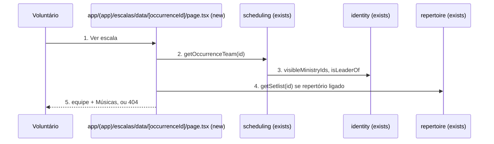
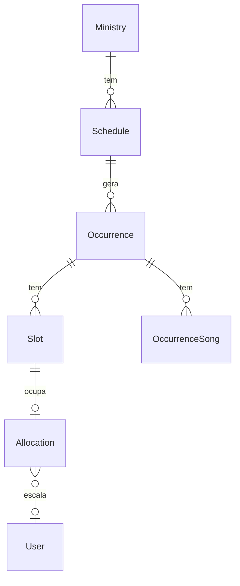

# Ajustes visuais

**Approved**: 2026-11-03 - user: "faça apenas os ajustes visuais pontuados. Faça o plano e aprove de imediato"

## Problem

Na tela inicial, o voluntário rola por três atalhos (Avisos, Repertório, Aniversariantes) antes de chegar ao que pede ação dele: confirmar uma escala, fazer check-in, ver a próxima data (`app/(app)/page.tsx:92-111`). Quem só tem escala hoje lê "Nenhuma escala próxima" logo abaixo do cartão de check-in do mesmo dia (`page.tsx:113`). O voluntário não tem onde ver quem serve com ele numa data: os cartões da home mostram só a própria função, e `/escalas` exige achar o dia no calendário. A cor que o admin escolhe para cada ministério (`Ministry.color`) só aparece em `/admin/ministerios`; quem está em mais de um ministério distingue os cartões só pelo texto. Trocar para `/escalas`, panorama ou visão geral mostra o mesmo esqueleto genérico de três cartões (`app/(app)/loading.tsx`), e nenhum esqueleto avisa leitor de tela que a página está carregando. No computador, o líder só chega à visão geral passando por `/admin`. O link "Músicas" nos cartões da home é texto sublinhado de 14 px, sem ícone, com área de toque menor que 44 px. Evidência: código lido; nenhum relato de usuário.

Quando entregar: a home abre pelo que pede ação, cada cartão leva à página da data com a equipe e as músicas, os cartões e a lista de escalas carregam a cor do ministério, as telas pesadas carregam com esqueleto do próprio formato, o líder acha a visão geral no menu lateral, e "Músicas" é um botão de toque fácil.

## Shape

Reaproveita `visibleMinistryIds`/`isLeaderOf` (identity) para o acesso à página da data, `getSetlist` (repertoire) para as músicas dela, e `getMySchedule`/`listMonthOccurrences` (scheduling) para levar a cor aos cartões. As regras que mudam o que aparece (quais grupos da home existem e se o vazio aparece, quem vê a data, quais vagas entram e em que ordem, qual cor vale, quais itens o menu tem) ficam em `src/modules/scheduling`, `src/modules/ministries/domain` e `src/ui/navItems.ts`, cobertas por vitest; as páginas só renderizam.

1. voluntário usa "Ver escala" num cartão da home -> `app/(app)/escalas/data/[occurrenceId]/page.tsx` (new) - pede a equipe e, com repertório ligado, as músicas
2. `scheduling` (exists) - `getOccurrenceTeam`: `requireUser`, lê a ocorrência, recusa id inválido, data cancelada, ministério que o usuário não vê e rascunho para quem não gerencia; devolve as vagas ativas por função, só com nomes
3. `identity` (exists) - `visibleMinistryIds` e `isLeaderOf` decidem o acesso
4. `repertoire` (exists) - `getSetlist` devolve a lista de músicas (mesma regra de acesso)
5. out: página com ministério na cor dele, data e hora, a equipe com "você" na própria vaga, e botão "Músicas"; código de acesso esperado vira 404

**Changes underneath**

| Front | What changes |
| --- | --- |
| domain | `UpcomingItem` ganha `ministryColor`; `MonthOccurrenceItem` ganha `ministryColor` - lidos pelos 4 grupos de cartão da home e por `OccurrenceRow` em `/escalas` |
| domain | `navItems` ganha "Visão geral" para líder e admin - lido por `AppShell` (menu lateral; a barra inferior não muda) e por `activeHref` |
| stored data | nada a migrar. `Ministry.color` já existe; cor nula ou fora de `#rrggbb` usa a cor da marca |
| readers | home (ordem, vazio, cor, "Ver escala", "Músicas"), `/escalas` (cor), menu lateral (Visão geral), esqueletos de `/escalas`, panorama e visão geral |
| readers | as imagens de `tests/e2e/__screens__` da home e de `/escalas` mudam e são regeneradas nesta feature; o seed do e2e ganha cor em Intercessão |

New: nothing - read only.

## Surface

| Route | In | Out | Status | Who |
| --- | --- | --- | --- | --- |
| `GET /escalas/data/[occurrenceId]` | `occurrenceId` (uuid) | página com ministério, título, data e hora, vagas ativas (função, nome ou "vaga aberta", "sem conta", "aguardando confirmação", "você") e "Músicas" quando o repertório está ligado | 200; página "Página não encontrada" (HTTP 200, ver AC 6) para id inválido, inexistente, data cancelada, ministério que o usuário não vê, ou rascunho para quem não gerencia; redirect para `/login` sem sessão | membro ativo do ministério ou admin; rascunho só para líder do ministério ou admin |

## Landing

None - nenhuma tabela, contrato consumido ou dependência nova; a rota nova é só leitura e a cor é derivada na leitura.

- Nothing else in this change is hard to reverse

## Criteria

### S1: Home abre pelo que pede ação (P1)

O voluntário vê primeiro o que precisa fazer, e o vazio só aparece quando não há nada.

**Acceptance Criteria**

1. WHEN um usuário abre `/` THEN o sistema SHALL mostrar, de cima para baixo: "Solicitações" (só líder e admin), "Você foi escalado!", "Sua Escala Hoje", "Próxima escala", "Depois", "Avisos em destaque", e por último o cartão com os atalhos Avisos, Repertório e Aniversariantes
   - `umCard` (um item em cada grupo) → os 4 títulos dos grupos ficam acima do atalho "Aniversariantes"
2. IF o usuário não tem item em "Você foi escalado!", "Sua Escala Hoje" nem em datas futuras confirmadas THEN o sistema SHALL mostrar "Nenhuma escala próxima"; IF tem item em qualquer um dos três THEN o sistema SHALL não mostrar "Nenhuma escala próxima"
   - nada → aparece; só hoje → não aparece; só pendente → não aparece; só futura → não aparece; hoje e pendente → não aparece

### S2: Página da data com a equipe (P1)

Cada cartão da home leva à página da data, onde o voluntário vê quem serve com ele e as músicas.

**Acceptance Criteria**

3. WHEN o usuário usa "Ver escala" num cartão de qualquer um dos 4 grupos da home THEN o sistema SHALL abrir `/escalas/data/<occurrenceId>` daquela data
4. WHEN um membro ativo abre `/escalas/data/<id>` de uma data publicada THEN o sistema SHALL mostrar o nome do ministério, o título da escala, a data e a hora, e uma linha por vaga ativa com a função e o nome, em ordem alfabética de função (pt-BR)
   - Louvor 18/10 para `lider` → Bateria "Lia Lider" com "você" e "aguardando confirmação"; Teclado "vaga aberta"; Violão "Ana Beatriz Moreira"; Vocal "Rafael Souza Lima"
5. IF a vaga está desativada THEN a página SHALL não mostrá-la; IF a vaga é de pessoa sem conta THEN SHALL mostrar o nome com "sem conta"
6. IF o id não é uuid, não existe, a data está cancelada, o usuário não vê o ministério, ou a data é rascunho e o usuário não gerencia o ministério THEN o sistema SHALL mostrar a página "Página não encontrada" já existente, sem nenhuma vaga da data (o status HTTP fica 200: o `loading.tsx` do grupo `(app)` faz streaming antes do `notFound()`, como já acontece em `/repertorio/escala`)
   - `abc` → 404; uuid inexistente → 404; cancelada → 404; não membro → 404; rascunho para voluntário → 404; rascunho para líder do ministério → 200; admin sem vínculo, data publicada → 200
7. The system SHALL mandar ao navegador da página da data só o nome de cada pessoa, nunca a linha `User` (sem e-mail, telefone ou aniversário)
8. WHERE o ministério tem repertório ligado, WHEN o usuário usa "Músicas" na página da data THEN o sistema SHALL abrir `/repertorio/escala/<occurrenceId>`; WHERE está desligado, a página SHALL não mostrar "Músicas"
9. WHEN o usuário usa "Início" no topo da página da data THEN o sistema SHALL voltar para `/`

### S3: Cor do ministério (P2)

Os cartões e a lista de escalas carregam a cor que o admin escolheu.

**Acceptance Criteria**

10. The system SHALL usar como cor do ministério o `Ministry.color` salvo quando ele é `#` seguido de 6 dígitos hexadecimais, e `#2a78cd` em qualquer outro caso
    - `#e0605a` → `#e0605a`; `#E0605A` → `#E0605A`; `null` → `#2a78cd`; `""` → `#2a78cd`; `red` → `#2a78cd`; `#12345` → `#2a78cd`; `#123456;x` → `#2a78cd`
11. WHEN o usuário abre `/` THEN cada cartão dos 4 grupos SHALL ter a borda esquerda de 4 px na cor do ministério daquela escala
    - `umCard` (Intercessão com `#e0605a`) → os 4 cartões com borda esquerda `rgb(224, 96, 90)` e 4 px
12. WHEN o usuário abre `/escalas` THEN o cartão de cada data SHALL ter a borda esquerda de 4 px na cor do ministério; e a página da data SHALL mostrar o nome do ministério com um marcador na mesma cor

### S4: Esqueletos por tela (P2)

As telas pesadas carregam com um esqueleto parecido com elas, anunciado para leitor de tela.

**Acceptance Criteria**

13. WHEN o usuário navega para `/escalas`, `/escalas/panorama` ou `/admin/visao-geral` THEN o sistema SHALL mostrar, enquanto carrega, um esqueleto próprio da rota: calendário de 7 colunas e 35 dias em `/escalas`, tabela de linhas em panorama, e 6 cartões em grade em visão geral
14. The system SHALL dar a cada esqueleto, o geral de `app/(app)/loading.tsx` incluso, `role="status"`, `aria-busy="true"` e o texto "Carregando…" visível só para leitor de tela

### S5: Visão geral no menu lateral (P2)

**Acceptance Criteria**

15. WHILE a tela tem 1024 px ou mais, WHEN um líder ou admin usa "Visão geral" no menu lateral THEN o sistema SHALL abrir `/admin/visao-geral` com "Visão geral" marcado como página atual e "Gestão" não marcado
16. IF o usuário não é líder nem admin THEN o menu lateral SHALL não ter "Visão geral"; e a barra inferior do celular SHALL continuar com as mesmas abas de hoje para todos

### S6: "Músicas" e "Ver escala" como botões (P2)

**Acceptance Criteria**

17. WHERE o ministério tem repertório ligado, cada cartão dos 4 grupos da home SHALL mostrar "Músicas" como botão com ícone de nota musical e altura de pelo menos 44 px, e usá-lo SHALL abrir `/repertorio/escala/<occurrenceId>`
    - `lider`, cartão de "Sua Escala Hoje" (Louvor) → "Músicas" com 44 px ou mais e ícone; Intercessão → sem "Músicas"
18. The system SHALL mostrar "Ver escala" como botão do mesmo formato, com ícone, e altura de pelo menos 44 px

## Out of scope

| Excluded | Why |
| --- | --- |
| Cor do ministério no panorama | o panorama mostra um ministério por vez; a cor não distingue nada ali |
| Check-in, confirmar, recusar e trocar na página da data | as ações continuam nos cartões da home; a página é de leitura |
| Roteiro do culto na página da data | feature própria, fora destes ajustes |
| Esqueleto nas outras rotas | as demais são formulários ou listas curtas; o esqueleto geral basta |
| Mudar `/escalas` para linkar a página da data | quem gerencia já vê a equipe no cartão da própria lista |
| Validar a cor no salvar do admin | o campo é `type="color"`; a cor inválida já cai na cor da marca na leitura |

## Assumptions

| Assumption | Chosen default | Rationale | Confirmed? |
| --- | --- | --- | --- |
| Onde ficam "Avisos em destaque" | depois dos grupos de escala, antes dos atalhos | o pedido era subir o que pede ação; aviso fixado é leitura | y - user delegated: "aprove de imediato" |
| Quando o vazio aparece | só sem pendente, sem hoje e sem futura | com pendente na tela, "Nenhuma escala próxima" contradiz o cartão de cima | y - user delegated: "aprove de imediato" |
| Endereço da página da data | `/escalas/data/<occurrenceId>` | fica sob "Escalas" no menu; `/escalas/[id]` já é id de série | y - user delegated: "aprove de imediato" |
| Quem vê a página da data | mesma regra de `getSetlist`: membro ativo ou admin; rascunho só para quem gerencia | consistente com calendário e músicas (AD-006) | y - user delegated: "aprove de imediato" |
| Volta da página da data | link "Início" para `/` | a entrada é pelos cartões da home | y - user delegated: "aprove de imediato" |
| Cor padrão | `#2a78cd` (`brand`) | é o padrão que os formulários de ministério já usam | y - user delegated: "aprove de imediato" |
| Lugar de "Visão geral" no menu | logo depois de "Gestão" | é uma tela de gestão | y - user delegated: "aprove de imediato" |

**Open questions:** none - all resolved or logged above.

## Differences from the source

None - the product matches the source

## Sources

- Resposta anterior desta conversa (lista de 7 ajustes visuais) - binding - escopo: ordem da home, vazio, página da data, cor do ministério, esqueletos, Visão geral no menu, "Músicas" como botão
