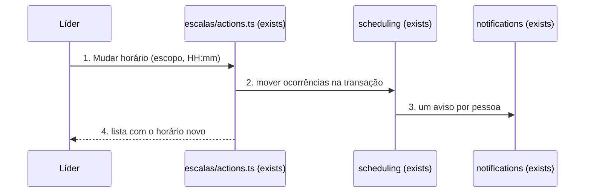
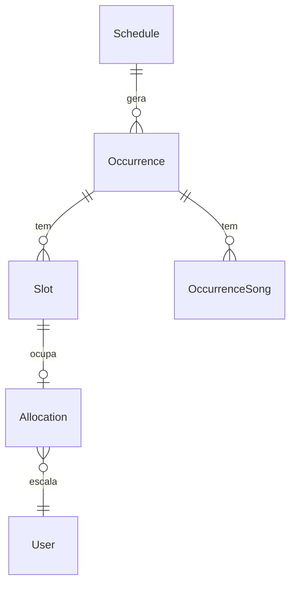

# Horário em lote

**Approved**: 2026-11-03 - user: "aprovado"

## Problem

O líder não consegue mudar o horário de várias datas já criadas de uma escala. "Editar escala" só muda o modelo (`updateSchedule.ts:19`): as ocorrências dos próximos 90 dias ficam no horário antigo, com as pessoas escaladas. Pior: `materializeOccurrences` roda logo depois e, como o unique `(scheduleId, date)` é o instante UTC, cria uma ocorrência nova vazia no mesmo dia, no horário novo. O voluntário passa a ver duas datas no mesmo dia, e a vaga vazia ao lado da antiga confunde quem se escala. Evidência: código lido em `app/(app)/escalas/actions.ts:91` e `materializeOccurrences.ts:36-41`; produção não foi consultada.

Quando entregar: o líder muda o horário de uma data, ou dela em diante, e as pessoas continuam nas vagas e recebem um aviso. Editar a escala move também as datas já criadas, sem duplicar.

## Shape

Reaproveita o escopo `SINGLE`/`FROM_HERE` de `deleteSchedule.ts`, a conversão dia + hora local de `domain/recurrence.ts` e `notifyIfPublished` para o aviso. A regra que decide o resultado (que datas mudam, o instante novo, colisão, quem é avisado e o texto) fica em `src/modules/scheduling`, coberta por testes de unidade com Prisma mockado, como `repeatSchedule.test.ts`.

1. líder usa "Mudar horário" no menu ⋮ de uma data, ou salva "Editar escala" -> `app/(app)/escalas/actions.ts` (exists) - valida o horário e traduz os códigos de erro
2. `scheduling` (exists) - `requireLeaderOf`, escolhe as ocorrências do escopo, calcula o instante novo no mesmo dia local, resolve colisão, persiste `Occurrence.date` e, em `FROM_HERE`, `Schedule.startTime`, tudo numa transação
3. `scheduling` (exists) -> `notifications` (exists) via `notifyIfPublished` - um aviso por pessoa escalada nas datas publicadas movidas
4. out: `revalidatePath("/escalas")`; a lista mostra o horário novo e `materializeOccurrences` não acha dia faltando

**Changes underneath**

| Front | What changes |
| --- | --- |
| domain | `Occurrence.date` deixa de ser fixo depois de criado. Quem lê: lista de escalas, panorama, home, lembrete do cron, check-in do dia, relatórios |
| domain | `updateSchedule` passava a afetar só datas novas; agora move as datas criadas a partir de agora quando o horário muda |
| stored data | nada a migrar. Duplicatas antigas ficam; viram fusão só quando uma mudança de horário cai nelas (AD-013) |
| readers | lembrete das 11h usa `date` na hora de rodar: lê o horário novo. Aviso já enviado (`dedupeKey` por ocorrência) não reenvia |
| domain | `materializeOccurrences` passa a comparar por dia local, não pelo instante: uma data com horário mudado continua ocupando o seu dia (door 3, AD-014) |

New: nothing - atualiza `Occurrence.date` e `Schedule.startTime`; apaga uma `Occurrence` só no caso de fusão (door 2).

## Surface

| Route | In | Out | Status | Who |
| --- | --- | --- | --- | --- |
| Server Action `retimeOccurrenceAction` | `occurrenceId`, `scope` (`SINGLE` ou `FROM_HERE`), `time` (`HH:mm`) | `{ ok: true, moved }` ou `{ ok: false, error }` em pt-BR | 200 `ok: true`; 200 `ok: false` por `FORBIDDEN`, `HORARIO_OCUPADO`, `DATA_PASSADA`, `HORARIO_INVALIDO` (Server Action não devolve outro código); 303 para `/login` sem sessão | líder do ministério ou admin; os outros recebem "Você não tem permissão para essa ação." |
| Server Action `updateScheduleAction` (exists) | igual a hoje | igual a hoje | 303 para `/escalas` ao salvar; 200 `ok: false` ganha `HORARIO_OCUPADO` | igual a hoje |

## Landing

| One-way door | Literal shape | Alternative rejected |
| --- | --- | --- |
| 1. Aviso de horário reusa o tipo existente | `type: "ASSIGNMENT"`, `dedupeKey: "retime:<lote>:<userId>"`, com `<lote>` um UUID por mudança | Novo valor `RETIME` em `NotificationType`: pede migração aplicada antes do deploy (AD-008) e nenhuma tela filtra por tipo |
| 2. Fusão apaga a duplicata vazia (AD-013) | apaga a `Occurrence` que já ocupa o instante novo quando ela não tem `Allocation` nem `OccurrenceSong`; os `Slot` saem em cascata | Sempre recusar: cancelar não libera o unique `(scheduleId, date)`, e o líder ficaria travado nas duplicatas que o bug já criou |

| 3. Materialização compara por dia local (AD-014) | `missingDays(expected, existing)` em `domain/recurrence.ts`: cria só a data cujo dia em `APP_TZ` não tem ocorrência da escala, em qualquer horário | Guardar o instante original da recorrência na `Occurrence`: pede coluna nova e migração aplicada antes do deploy (AD-008) |

- Nothing else in this change is hard to reverse

## Criteria

### S1: Mudar o horário de uma data ou dela em diante (P1)

**Acceptance Criteria**

1. WHEN o líder usa "Mudar horário" numa data, escolhe "Só esta data" e um horário THEN essa ocorrência SHALL ir para o mesmo dia local no horário novo, com vagas, pessoas, status de confirmação, check-in, músicas e publicação intactos, e `Schedule.startTime` SHALL continuar igual
   - 18/10 18:00 → 18:30 → `2026-10-18T21:30:00Z`; 18/10 18:00 → 00:30 → `2026-10-18T03:30:00Z` (mesmo dia local, não o dia seguinte)
2. WHEN o líder escolhe "Esta e as próximas" THEN todas as ocorrências da escala com data igual ou posterior à escolhida SHALL mudar, canceladas incluídas, e `Schedule.startTime` SHALL virar o horário novo; datas anteriores SHALL ficar
   - escolhe 25/10 com datas em 18/10, 25/10 e 01/11 → mudam 25/10 e 01/11; 18/10 fica; 01/11 cancelada também muda
3. WHEN o líder salva "Editar escala" com horário diferente THEN toda ocorrência da escala com data a partir de agora SHALL mudar como em "Esta e as próximas", e a materialização seguinte SHALL não criar segunda ocorrência no mesmo dia
   - horário 18:00 → 18:30 com 13 datas criadas → 13 datas às 18:30 e 0 novas; salvar sem mudar o horário → nenhuma data muda
4. IF o horário novo é igual ao atual THEN nada SHALL mudar e ninguém SHALL ser avisado
5. IF o instante novo já é de outra ocorrência da mesma escala sem pessoa e sem música THEN essa outra SHALL ser apagada e a mudança SHALL seguir
6. IF o instante novo já é de outra ocorrência da mesma escala com pessoa ou música THEN nada SHALL mudar e a tela SHALL mostrar "Já existe outra data desta escala em DD/MM às HH:mm."
   - vazia → apagada; com 1 pessoa → recusa; só com música → recusa; em "Esta e as próximas", 1 conflito em 3 datas → nenhuma das 3 muda
7. IF duas mudanças chegam ao mesmo instante para a mesma escala THEN uma SHALL vencer e a outra SHALL receber a mesma mensagem do critério 6, sem erro genérico
8. IF a data escolhida em "Só esta data" já passou THEN nada SHALL mudar e a tela SHALL mostrar "Essa data já passou."
   - em "Esta e as próximas", datas que já passaram SHALL ficar como estão
9. IF o horário não é `HH:mm` entre 00:00 e 23:59 THEN nada SHALL mudar e a tela SHALL mostrar "Informe um horário válido."
10. IF quem usa não lidera o ministério da escala nem é admin THEN nada SHALL mudar e a tela SHALL mostrar "Você não tem permissão para essa ação."

### S2: Aviso para quem está escalado (P1)

**Acceptance Criteria**

11. WHEN uma mudança move datas publicadas com pessoas escaladas (`PENDING` ou `CONFIRMED`) THEN cada pessoa SHALL receber uma notificação só, com título "Horário alterado" e corpo "<título da escala>: <datas> agora às HH:mm."
    - 1 data → "Culto Louvor: 18/10 agora às 18:30."; 2 datas → "18/10 e 25/10"; 5 datas → "18/10, 25/10, 01/11 e mais 2 datas"; mesma pessoa em 2 vagas da mesma data → 1 aviso
12. IF a data movida está em rascunho THEN ninguém escalado nela SHALL ser avisado por ela
13. IF a vaga é de convidado sem conta (`guestName`) THEN ninguém SHALL ser avisado por ela
14. IF o envio do aviso falha THEN a mudança de horário SHALL continuar salva

### S3: Telas (P1)

**Acceptance Criteria**

15. WHEN o líder abre o menu ⋮ de uma data THEN SHALL ver "Mudar horário"; usá-lo SHALL abrir uma folha com o horário atual preenchido, as opções "Só esta data" e "Esta e as próximas" (padrão "Só esta data") e "Salvar"
16. WHEN o líder usa "Salvar" THEN a folha SHALL fechar e a lista SHALL mostrar o horário novo na data; com erro, a folha SHALL ficar aberta com a mensagem
17. WHILE o formulário está em "Editar escala" THEN o campo de horário SHALL mostrar "Muda também as datas já criadas a partir de hoje."

## Out of scope

| Excluded | Why |
| --- | --- |
| Mudar título, funções ou recorrência em lote | Usuário escolheu "Só horário" |
| Limpar duplicatas antigas em produção | Usuário escolheu "Só impedir novas"; a fusão do critério 5 só age quando uma mudança cai nelas |
| Mudar o dia da data | Pedido é horário; mudar dia mexe na recorrência |
| Escalas de vários ministérios de uma vez | Usuário escolheu "Várias datas da mesma escala" |
| Escolher datas soltas à mão | Mesma resposta |

## Assumptions

| Assumption | Chosen default | Rationale | Confirmed? |
| --- | --- | --- | --- |
| Alcance | Datas da mesma escala, por "Só esta data" ou "Esta e as próximas" | Usuário escolheu "Várias datas da mesma escala" e "Menu da data + editar" | y |
| Campos | Só horário | Usuário escolheu "Só horário (Recomendado)" | y |
| Duplicatas antigas | Ficam; só a fusão age | Usuário escolheu "Só impedir novas" | y |
| Aviso | Um por pessoa, só datas publicadas | Usuário escolheu "Sim, um aviso por pessoa (Recomendado)" | y |
| Colisão | Fusão se a outra está vazia, recusa se não | Usuário escolheu "Junta se a outra estiver vazia (Recomendado)" | y |
| Canceladas em "Esta e as próximas" | Mudam junto | Se ficassem, a materialização recriaria a data cancelada no horário novo | n |
| Pedido de troca aberto na data | Segue aberto, na mesma vaga | A vaga não muda, só o horário | n |
| Lembrete já enviado | Não reenvia; o aviso de horário cobre a mudança | `dedupeKey` do lembrete é por ocorrência | n |
| Link do aviso | `/` | É onde o voluntário vê as próprias escalas | n |
| Aviso de data cancelada | Não avisa | A data não acontece; quem estava nela já não vai | n |

**Open questions:** none - all resolved or logged above.

## Sources

- Pedido no chat, 2026-11-01: "alterar várias escaas ao mesmo tempo (como no caso do horário)"
- Respostas no chat, 2026-11-01 e 2026-11-03, copiadas em `Assumptions`
