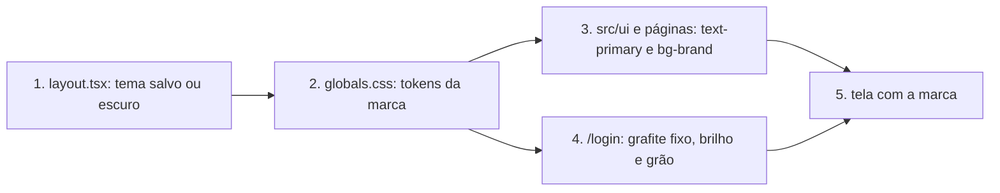

# Identidade de marca no app

**Approved**: 2026-10-30 - user: "aprovado"

## Problem

O app usa o indigo herdado do projeto SERVIR, azul-marinho slate no tema escuro e o nome sem acento ("Getsemani"), enquanto a igreja tem manual próprio: Azul Getsêmani `#2A78CD`, grafite `#141518`, "Getsêmani". Quem abre o app vê outra marca, não a do telão e do YouTube; o símbolo só aparece no ícone do PWA. Evidência: `app/globals.css` declara "claro, indigo (ref: projeto SERVIR)"; `AppShell.tsx:36` escreve o nome em texto puro.

Na tela inicial há cards com largura diferente dos vizinhos. Evidência no código: em `UpcomingCarousel.tsx:31` cada card de "Depois" tem `w-[85%]` (304 px contra 358 px dos outros, a 390 px de janela), e a partir de `lg` um card sozinho em "Depois", "Você foi escalado!" ou "Sua Escala Hoje" ocupa metade da linha (`lg:grid-cols-2`). O seed do e2e não tem item em "Depois", então a captura atual não mostra o caso. Além disso, "Check-in feito" usa `text-success`, token que não existe, e fica sem cor.

Quando entregar: o app abre em grafite com o azul da marca, o nome certo, o símbolo no login e no menu lateral, e todos os cards da tela inicial alinhados na mesma largura. O layout e o tamanho das telas não mudam.

## Shape

Reaproveita os tokens de `app/globals.css` e as primitivas de `src/ui`, sem componente novo de tema; só o símbolo ganha um componente pequeno. Não há regra de negócio: o que decide o resultado são tokens e classes, provados por teste de leitura de arquivo (como `tests/unit/themeTokens.test.ts`) e pelos snapshots do e2e.

Single module - `app/globals.css` + `src/ui`, sem domínio nem banco.

1. tema salvo em `localStorage` -> `app/layout.tsx` (exists) - script aplica `.dark` antes do primeiro paint; sem valor salvo, escuro
2. `.dark` no `<html>` -> `app/globals.css` (exists) - resolve os tokens da marca
3. `src/ui/*` e páginas (exists) - consomem tokens; preenchimento sólido passa a `bg-brand` (door 1)
4. `/login` (exists) - força grafite, símbolo branco, brilho no pé e grão
5. out: tela renderizada com a marca; o script cria o `theme-color` (fora do `viewport` do Next, que duplicava o meta na hidratação) e `ThemeToggle` (exists) troca tema e meta

**Changes underneath**

| Front | What changes |
| --- | --- |
| domain | `primary` era texto e preenchimento; agora é só texto, ícone e tints. `bg-primary` sólido vira `bg-brand` (8 usos) |
| stored data | nada a migrar. `Ministry.color` já salva continua; só o padrão de ministério novo muda |
| stored data | `localStorage.theme` é respeitado. Quem nunca clicou no botão passa de "segue o sistema" a escuro |
| readers | snapshots de `tests/e2e/__screens__` são regerados: toda cor muda. `threshold: 0` entra junto, porque o padrão de 0,2 deixava passar a cor antiga |
| domain | `bg-primary/10` com texto azul vira `bg-accent-soft` (5 usos), tint sólido que passa 4,5:1. Fundo sólido vermelho com texto branco usa `danger-fill` |

Data: none - só apresentação; nenhum modelo ou migração.

## Surface

None - nothing consumed outside

## Landing

| One-way door | Literal shape | Alternative rejected |
| --- | --- | --- |
| 1. Separar azul de texto de azul de preenchimento | `--color-primary` para texto e ícone; `--color-brand: #2a78cd` para fundo sólido com texto branco, em `bg-brand` | Um token só: `#2A78CD` dá 4,06:1 como texto sobre grafite; `#308EF0` dá 3,36:1 sob texto branco. Nenhum valor único passa 4,5:1 nos dois usos |
| 2. Tema padrão escuro (AD-010) | `stored ? stored === "dark" : true` no `THEME_INIT_SCRIPT` | Seguir o sistema: rejeitado pelo usuário, que escolheu "Escuro por padrão" |
| 3. Só Gotham até haver licença (AD-011) | sem `@font-face` de Monument Extended em `public/` | Servir o arquivo "Free for Personal Use": a licença proíbe redistribuir, e o navegador baixa a fonte |

- Nothing else in this change is hard to reverse

## Criteria

### S1: Cards da tela inicial na mesma largura (P1)

Todo card de "Próxima escala", "Depois", "Você foi escalado!" e "Sua Escala Hoje" alinha com os demais.

**Acceptance Criteria**

1. WHILE a janela tem menos de 1024 px THEN cada card de "Depois" SHALL ter a mesma largura de "Próxima escala"
   - 390 px com 1 item → 358 px; 390 px com 3 itens → 358 px e "1 de 3" visível
2. WHEN alguém desliza "Depois" com 2 ou mais itens em janela abaixo de 1024 px THEN o carrossel SHALL mudar de card e atualizar o contador "N de M"
3. WHILE a janela tem 1024 px ou mais e um grupo tem 1 item THEN o card SHALL ocupar a linha inteira
   - grupos: "Depois", "Você foi escalado!", "Sua Escala Hoje"; 1 item → largura de "Próxima escala"; 2 itens → duas colunas; 3 itens → duas colunas e o terceiro em meia linha
4. WHEN o voluntário faz check-in THEN "Check-in feito" SHALL aparecer em `text-primary`, e nenhum arquivo SHALL usar `text-success`

### S2: Cores da marca (P1)

Claro e escuro usam só a paleta do manual.

**Acceptance Criteria**

5. O tema escuro SHALL usar `bg #141518`, `surface #1c1e23`, `border #2b2e35`, `text #f4f6f9`, `text-muted #8c929c`, `primary #308ef0`, `danger #e0605a`
6. O tema claro SHALL usar `bg #f4f6f9`, `surface #ffffff`, `text #141518`, `primary #164f94`
7. Os dois temas SHALL usar `brand #2a78cd` com texto `#ffffff` nos preenchimentos sólidos e `#164f94` no hover
8. Cada par de texto dos dois temas SHALL ter contraste de pelo menos 4,5:1
   - `primary` sobre `surface`; `text-muted` sobre `surface`; branco sobre `brand` (4,50:1) → passam; `danger` claro `#ef4444` já existente sobre `surface` (3,76:1) → exceção listada, fora do escopo
9. Nenhum arquivo de `app/`, `src/` e `public/` SHALL conter `#4f46e5`, `#6366f1`, `#6d28d9`, `#020617`, `rgba(79,70,229` ou classe `indigo-*`
10. WHEN um ministério novo é criado sem escolher cor THEN a cor padrão SHALL ser `#2a78cd`, e um ministério existente SHALL manter a cor salva
11. O `manifest.webmanifest`, a `offline.html`, o `global-error` e `theme-color` SHALL usar `#141518` no lugar do fundo slate

### S3: Tema escuro por padrão (P1)

**Acceptance Criteria**

12. WHEN alguém abre o app sem `theme` salvo THEN o `<html>` SHALL ter `.dark` antes do primeiro paint, mesmo com o sistema em claro
13. WHEN alguém com `theme=light` salvo abre o app THEN o app SHALL abrir claro, com `theme-color` `#f4f6f9`
14. WHEN alguém usa o botão de tema em `/perfil` THEN o tema SHALL trocar na hora, ficar salvo e `theme-color` SHALL acompanhar

### S4: Nome e logo (P2)

**Acceptance Criteria**

15. Todo texto visível SHALL escrever "Getsêmani": título da página, manifest, `offline.html`, menu lateral, guia de instalação, instruções de push, notificações; identificador interno (chave de cache, pacote, nome de arquivo) SHALL continuar igual
16. WHILE o menu lateral está visível THEN SHALL mostrar o símbolo com pelo menos 24 px de altura ao lado de "Getsêmani": azul no tema claro, branco no escuro, sem sombra nem deformação
17. WHEN alguém abre `/login` THEN a tela SHALL mostrar o símbolo branco com pelo menos 24 px, sobre grafite, em qualquer tema salvo

### S5: Login com assinatura (P2)

**Acceptance Criteria**

18. WHEN alguém abre `/login` THEN a tela SHALL ter fundo grafite com brilho azul subindo do rodapé em 30% a 40% da altura
19. WHEN alguém abre `/login` THEN a tela SHALL ter grão monocromático estático a 7% de opacidade em `mix-blend-mode: overlay`, sem bloquear clique nem foco do formulário
20. IF uma tela fora de `/login` renderiza THEN ela SHALL não ter grão nem brilho no pé

## Out of scope

| Excluded | Why |
| --- | --- |
| Monument Extended e títulos em caixa alta | Licença só pessoal; usuário escolheu "Só Gotham por ora" |
| Grão e brilho nas telas de uso | Só no login, conforme a opção aprovada |
| Layout, tamanhos, espaçamentos e raios | Usuário gosta do visual atual |
| Selo do PWA | `icon-192/512` já são o selo azul do manual |
| Logotipo escrito "Getsêmani" com o símbolo no "ê" | Não existe arquivo; o manual registra a falta |
| Cor de ministério já salva | É dado escolhido pelo admin |
| Símbolo no cabeçalho do celular | Opção aprovada cita login e menu lateral |
| Vermelho do tema claro abaixo de AA como texto | Já existe assim e não é da paleta; arrumar é outra tarefa. O botão vermelho sólido entrou, via `danger-fill` |
| Movimento | Fade curto e easing do app já combinam com o manual |
| Frases de marca (missão, headline, tema do ano) | Não aparecem no app e ninguém pediu |

## Assumptions

| Assumption | Chosen default | Rationale | Confirmed? |
| --- | --- | --- | --- |
| Quais mudanças entram | Cores, nome, logo, login | Usuário marcou as quatro opções | y |
| Tema padrão | Escuro; claro segue no perfil | Usuário escolheu "Escuro por padrão" | y |
| Fonte | Só Gotham | Usuário escolheu "Só Gotham por ora" | y |
| Card "errado" | Corrigir os três casos (85% no celular, meia linha em `lg`) | O usuário não disse a largura da janela; os três têm a mesma causa | n |
| Carrossel "Depois" com vários itens | 100% da largura, sem espiar o próximo; o contador "N de M" segue | Igual a "Você foi escalado!" e "Sua Escala Hoje" | n |
| Azul de texto no claro | Azul profundo `#164f94` | `#2A78CD` dá 4,16:1 sobre o fundo claro `#f4f6f9`; este está na paleta (7,52:1) | n |
| Login no tema claro salvo | Sempre grafite | O símbolo branco, o brilho e o grão pedem fundo escuro | n |
| Tons sem valor no manual | `surface-2` escuro `#24262c`, `accent-soft` `#e8f1fb` e `#16263a`; `text-muted` e `surface-2` claros seguem como hoje | Neutros e tints derivados da paleta | n |

**Open questions:** none - all resolved or logged above.

## Differences from the source

| Source shows | Product shows | Confirmed |
| --- | --- | --- |
| Fundo grafite sempre, "nunca branco" | Tema claro segue disponível no perfil | y - AD-010 |
| Títulos em Monument Extended, caixa alta | Títulos em Gotham, caixa normal | y - AD-011 |
| Grão em tudo | Grão só em `/login` | y - AD-012 |

## Sources

- `C:\Users\Omena\Documents\Gui\Igreja\Identidade Visual\Manual de Marca.md` (edição 2026; este vale sobre o HTML) - non-binding - user: "Eu gosto do visual atual" - informa paleta, logo e assinatura; o layout atual fica
- `Manual de Marca.html` - non-binding - user: "Eu gosto do visual atual" - de lá vêm `#1c1e23`, `#2b2e35`, `#e0605a` e a receita do grão
- `Logo/simbolo-azul.png`, `Logo/simbolo-branco.png` - arquivos oficiais, usados sem alteração
