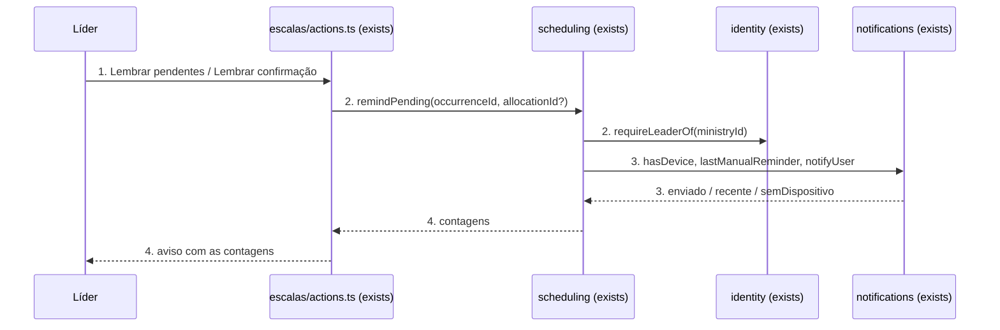
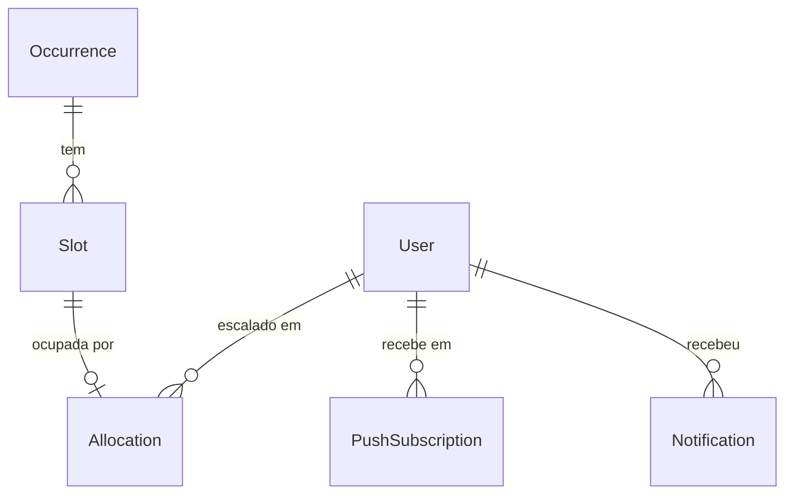

# Lembrete de confirmação e revisão dos modais

**Approved**: 2026-11-09 - user: "pode seguir"

## Problem

Quem lidera um ministério vê na escala quem ainda está "aguardando confirmação", mas não tem como cobrar pelo app: o único lembrete é o do cron (`app/api/cron/reminders/route.ts`), que sai uma vez na véspera e uma vez no dia, para todo mundo, sem o líder escolher quando nem quem. Para cobrar antes disso, o líder sai do app e manda mensagem pessoa por pessoa. Evidência: pedido do usuário ("eu quero notificar novamente TODOS (ou somente uma pessoa) que ainda não confirmou escala via app"); código lido.

Nos modais de baixo (`src/ui/BottomSheet.tsx`), o fechar no computador é a palavra "Fechar" centralizada no topo do painel, acima do conteúdo; no celular é só a alça. O usuário apontou isso no modal que abre ao tocar no nome de um escalado para marcar presença ("fechar no meio"). No menu lateral do computador (`src/ui/AppShell.tsx:37-40`) o símbolo da igreja aparece com o nome "Getsêmani" ao lado; o usuário: "Não use logo da igreja com o nome ao lado, não fica esteticamente bonito".

Quando entregar: o líder lembra, de dentro do app, todos os pendentes de uma data ou uma pessoa só, sabe na hora quantos receberam, e não consegue mandar o mesmo lembrete à mesma pessoa duas vezes na mesma hora; todo modal de baixo fecha por um X no canto direito do cabeçalho; o menu lateral mostra só o símbolo.

## Shape

Reaproveita `notifyUser` (idempotência por `dedupeKey`, tipo `REMINDER` já existente), `reminderCopy` (texto "Confirme sua escala") e `requireLeaderOf` (líder do ministério ou admin); nenhuma tabela nova. As regras que mudam o resultado (quem é elegível, a janela de uma hora, a contagem por desfecho) ficam numa função pura em `src/modules/scheduling/domain` e num serviço em `src/modules/scheduling/services`, cobertos por vitest; a tela só mostra o resultado.

1. líder usa "Lembrar pendentes" no menu da data, ou "Lembrar confirmação" no modal da vaga -> `app/(app)/escalas/actions.ts` (exists) - `remindPendingAction(occurrenceId, allocationId?)` chama o serviço e traduz erro para pt-BR
2. `scheduling` (exists) - `remindPending`: lê a ocorrência, `requireLeaderOf(ministryId)`, recusa data cancelada, rascunho ou já começada, filtra alocações com conta e `PENDING` (só a pedida, quando há `allocationId`)
3. `notifications` (exists) - para cada alocação: sem dispositivo cadastrado → `semDispositivo`; lembrete manual na última hora → `recente`; senão `notifyUser` com `dedupeKey` da janela (door 1) → `enviado`
4. out: `{ ok, enviados, recentes, semDispositivo }` vira aviso no card da data ou no modal; `revalidatePath` não é necessário (nada de domínio muda)

**Changes underneath**

| Front | What changes |
| --- | --- |
| domain | nada muda de significado; `Notification` tipo `REMINDER` passa a ter também lembretes manuais, distinguidos pelo prefixo do `dedupeKey` |
| stored data | nada a migrar; linhas novas em `Notification` |
| readers | `wasNotified` lê só chaves `assign:`; o cron de lembretes usa `reminder-<estágio>:` - nenhum dos dois lê o prefixo novo |

New: nada - só linhas novas em `Notification`. One-way constraints: `dedupeKey` único já existe e segura a corrida (door 1).

## Surface

| Route | In | Out | Status | Who |
| --- | --- | --- | --- | --- |
| Server Action `remindPendingAction` | `occurrenceId`, `allocationId?` | `{ ok: true, enviados, recentes, semDispositivo }` ou `{ ok: false, code, ref }` | 200 `ok: true`; 200 `ok: false` por `FORBIDDEN`, `NOT_REMINDABLE` (Server Action não devolve outro código); 303 para `/login` sem sessão | líder do ministério da data ou admin; os outros recebem "Você não tem permissão para essa ação." |

## Landing

| One-way door | Literal shape | Alternative rejected |
| --- | --- | --- |
| 1. chave do lembrete manual em `Notification.dedupeKey` | `lembrete-manual:<allocationId>:<floor(epochMs / 3600000)>`; a janela de uma hora é contada pelo `createdAt` da última linha com prefixo `lembrete-manual:<allocationId>:` | novo valor `NUDGE` em `NotificationType`: exige migração que fica bloqueando o go-live (AD-008) e nenhum leitor precisa distinguir o tipo |

- Nothing else in this change is hard to reverse

## Criteria

### S1: lembrar todos os pendentes de uma data (P1)

O líder dispara, numa data, o lembrete para todo escalado com conta que ainda não confirmou.

**Acceptance Criteria**

1. WHILE a data está publicada, ativa, ainda não começou e tem ao menos 1 escalado com conta em `PENDING`, WHEN quem gerencia o ministério abre o menu "Mais ações" da data THEN o sistema SHALL mostrar o item "Lembrar pendentes (N)", com N = número desses escalados
2. IF a data é rascunho, cancelada, já começou, ou não tem escalado com conta em `PENDING` THEN o menu SHALL omitir "Lembrar pendentes"
3. WHEN o líder usa "Lembrar pendentes (N)" THEN o sistema SHALL pedir confirmação com o título "Lembrar N pessoas que não confirmaram?" (singular "Lembrar 1 pessoa que não confirmou?") e só envia depois de "Lembrar"
4. WHEN o líder confirma THEN o serviço SHALL enviar push só para os escalados com conta em `PENDING` daquela data
   - 3 vagas: Ana `PENDING`, Bia `CONFIRMED`, convidado sem conta → só Ana recebe; vaga desativada com alocação `PENDING` → não recebe
5. WHEN o envio termina THEN o card da data SHALL mostrar "Lembrete enviado para N pessoa(s)", seguido de " · M já lembrada(s) na última hora" quando M > 0 e " · K sem notificações ativadas" quando K > 0
6. THE lembrete SHALL ter título "Confirme sua escala: <ministério>", corpo "<função> · <data e hora>" e abrir `/`

### S2: lembrar uma pessoa (P1)

O líder lembra um escalado específico pelo modal da vaga.

**Acceptance Criteria**

7. WHILE o escalado tem conta, está `PENDING` e a data está publicada, ativa e não começou, WHEN quem gerencia toca no nome dele na escala THEN o modal SHALL mostrar o botão "Lembrar confirmação"
8. IF o escalado já confirmou, é convidado sem conta, ou a data é rascunho, cancelada ou já começou THEN o modal SHALL omitir "Lembrar confirmação"
9. WHEN o líder usa "Lembrar confirmação" THEN o serviço SHALL enviar push só para aquela alocação, e o modal SHALL mostrar "Lembrete enviado", "Já lembrado na última hora" ou "Sem notificações ativadas", conforme o desfecho

### S3: limite e permissão (P1)

10. IF a mesma alocação recebeu lembrete manual há menos de 60 minutos THEN o serviço SHALL não enviar e contar como `recentes`
    - último há 59 min → não envia; há 60 min → envia; só lembrete do cron (`reminder-vespera:`) há 5 min → envia
11. IF dois pedidos para a mesma alocação chegam ao mesmo tempo THEN o serviço SHALL enviar no máximo 1 push, garantido pelo `dedupeKey` único da janela (door 1)
12. IF o escalado não tem nenhum `PushSubscription` THEN o serviço SHALL não gravar `Notification` e contar como `semDispositivo` (o limite de 1 hora não começa)
13. IF quem chama não lidera o ministério da data e não é admin THEN a action SHALL devolver `ok: false` com `FORBIDDEN` e nenhum push sai
14. IF a data é rascunho, cancelada ou já começou, ou o `allocationId` não pertence à data, não tem conta ou não está `PENDING`, THEN a action SHALL devolver `ok: false` com `NOT_REMINDABLE`, mostrado como "Essa escala não pode ser lembrada agora."

### S4: fechar dos modais (P1)

15. THE `BottomSheet` SHALL mostrar, em toda largura, um cabeçalho com o título do modal à esquerda (quando houver) e um botão de ícone X à direita com `aria-label="Fechar"` e área de toque de pelo menos 44 × 44 px; a palavra "Fechar" centralizada deixa de existir
16. WHILE a largura é menor que 1024 px the `BottomSheet` SHALL manter a alça de arrastar acima do cabeçalho, sem ser botão
17. WHEN o usuário usa o X, toca fora do painel ou aperta Esc THEN o modal SHALL fechar (vale para o modal da vaga, vaga extra, mudar horário, instalar app e os que usam `Sheet`)

### S5: menu lateral só com símbolo (P1)

18. WHILE a largura é pelo menos 1024 px the menu lateral SHALL mostrar só o símbolo da igreja, sem o texto "Getsêmani" ao lado, mantendo "Getsêmani" como nome acessível da imagem

## Out of scope

| Excluded | Why |
| --- | --- |
| lembrar todos os pendentes das próximas datas do ministério | usuário escolheu "Por data" |
| lembrete manual por WhatsApp/e-mail | só existe canal push hoje |
| mensagem personalizada pelo líder | não pedido |
| histórico de lembretes enviados | não pedido; o limite de 1 hora só usa a última linha |
| X no `ConfirmDialog` | já tem "Cancelar" explícito; não é modal de baixo |
| logo do login | só símbolo, sem nome ao lado; já atende |

## Assumptions

| Assumption | Chosen default | Rationale | Confirmed? |
| --- | --- | --- | --- |
| recorte do "todos" | pendentes de uma data | usuário escolheu "Por data (Recomendado)" | y |
| limite de reenvio | 1 lembrete manual por alocação a cada 60 min, janela móvel | usuário escolheu "1x por hora (Recomendado)" | y |
| fechar dos modais | X no canto direito do cabeçalho, alça no celular | usuário escolheu "X no canto direito (Recomendado)" | y |
| logo do menu lateral | só o símbolo | usuário escolheu "Só o símbolo (Recomendado)" | y |
| quem pode lembrar | líder do ministério da data ou admin (`requireLeaderOf`) | mesma regra de alocar e marcar presença | n |
| lembrete do cron conta para o limite | não: só lembrete manual conta | o líder decide reforçar mesmo depois do automático | n |
| confirmação antes de lembrar todos | sim, com `ConfirmDialog`; individual sem confirmação | envio em massa é externo e não se desfaz | n |
| outros defeitos visuais nos modais | ao fotografar cada modal no build, corrigir desalinhamentos evidentes do mesmo tipo e listar em `checks.md` | usuário disse "alguns modais", só nomeou um | n |

**Open questions:** none - all resolved or logged above.

## Differences from the source

None - no binding source (sem capturas; pedido em texto).

## Sources

- pedido do usuário em 2026-11-09 - binding - escopo (lembrar todos/uma pessoa, modais, logo)
