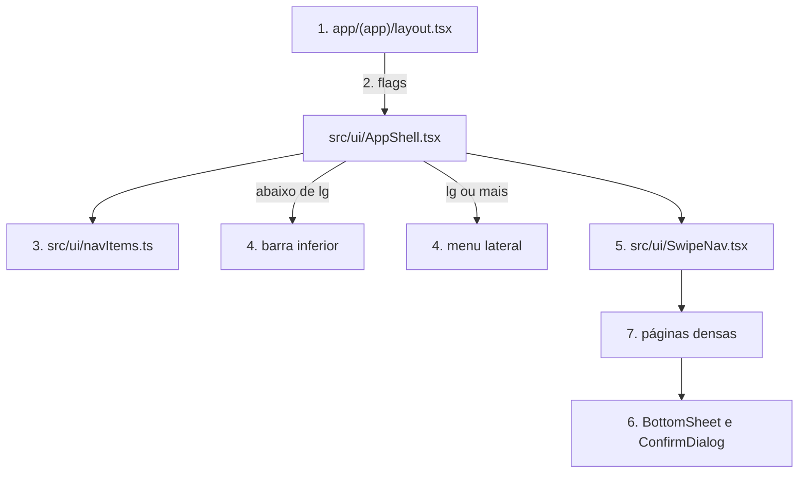

# Responsividade web

**Approved**: 2026-10-30 - user: "Aprovado!"

## Problem

O app só tem layout de celular. Em qualquer monitor, o conteúdo fica numa coluna de 448 px e a navegação numa barra inferior de 4 ou 5 abas (`src/ui/AppShell.tsx:38,56`). Quem paga são líderes e admins, que montam escala e acompanham a gestão no computador: a grade do Panorama rola de lado dentro dos 448 px, Gestão vira uma coluna longa, e Avisos, Repertório, Aniversariantes, Agenda e Panorama ficam a dois cliques.

O mouse também funciona mal. Arrastar sobre a página pode trocar de aba (`src/ui/SwipeNav.tsx:29-41`), carrosséis escondem cards sem scrollbar nem seta, e sheets não fecham com Esc. Isso vem de leitura do código: nenhuma tela foi aberta em navegador e não há dado de uso. O levantamento está em `docs/discovery/2026-10-30-responsividade-web.md`.

Quando isso sair, um líder em janela de 1024 px ou mais navega por um menu lateral, vê Panorama, Escalas e Gestão usando a largura da tela e usa tudo com mouse e teclado. Quem está no celular ou tablet não percebe mudança de layout.

## Shape

Reusa o `AppShell`, os componentes de `src/ui/` e as páginas atuais com variantes `lg:` do Tailwind, sem rotas nem componentes de tela duplicados. As regras que decidem resultado (itens do menu, item ativo, início do gesto de swipe) ficam em funções puras em `src/ui/`, alcançadas pelo vitest; o layout é provado no Playwright.

1. requisição autenticada -> `app/(app)/layout.tsx` (exists) - resolve `isLeader`, `pendingCount` e agora `hasRepertoire`, via `visibleMinistryIds` e `repertoireMinistries`
2. `app/(app)/layout.tsx` (exists) -> `src/ui/AppShell.tsx` (exists) - entrega as flags de permissão
3. `src/ui/navItems.ts` (new) - decide quais itens aparecem, em que ordem, e qual está ativo
4. `src/ui/AppShell.tsx` (exists) - desenha barra inferior abaixo de `lg` e menu lateral a partir de `lg`, fora do `SwipeNav`
5. `src/ui/SwipeNav.tsx` (exists) - ignora gesto iniciado por mouse
6. `src/ui/BottomSheet.tsx` e `src/ui/ConfirmDialog.tsx` (exists) - viram diálogo acessível, centralizado a partir de `lg`
7. out: páginas densas (exists) usam a largura com variantes `lg:`; nada é persistido

**Changes underneath**

| Front | What changes |
| --- | --- |
| domain | nada: permissões continuam em `authz.ts` e `memberships.ts` |
| stored data | nothing to migrate |
| readers | todo layout autenticado faz uma leitura a mais para `hasRepertoire`; todas as telas com sheet ou confirmação herdam Esc e foco |
| docs | `CLAUDE.md:86` deixa de fixar `max-w-md` como regra única |

Data: none - muda só apresentação, e `repertoireMinistries` já existe em `src/modules/ministries/services/modules.ts`.

## Surface

None - nothing consumed outside. Nenhuma rota é adicionada ou muda de assinatura.

## Landing

| One-way door | Literal shape | Alternative rejected |
| --- | --- | --- |
| Padrão de layout web | `lg:` (1024 px) é o único ponto de corte; a classe sem prefixo é sempre a de celular (AD-009) | `md:` para tablet, que cria um terceiro layout para provar em cada tela e foi recusado pelo responsável |
| Harness e2e com login real | `supabase/config.toml` e `npx supabase start` em Docker, `tests/e2e/`, usuários criados por script com `DATABASE_URL` em localhost | Bypass de login por variável de ambiente, porque abre no código de produção o caminho de sessão forjável que `tests/unit/sessionForgery.test.ts` protege |
| Config da Supabase fora da raiz | `tests/e2e/supabase/config.toml` com `--workdir tests/e2e` | `supabase/` na raiz, porque o CLI parseia o `.env` de produção e falha nele |
| Relógio do servidor de teste | `NODE_OPTIONS=--require ./tests/e2e/harness/fixedClock.cjs` desloca `Date` só no processo do Playwright | Baseline sem data fixa, que vence no dia seguinte; ou ler a data de env no código do app, que muda produção por causa de teste |

- Nothing else in this change is hard to reverse

## Criteria

### S1: Líder navega por menu lateral (P1)

Em janela larga, todos os destinos ficam a um clique.

**Acceptance Criteria**

1. WHILE a janela tem 1024 px ou mais THEN o sistema SHALL mostrar o menu lateral e esconder a barra inferior
   - 1023 px → só barra inferior; 1024 px → só menu lateral
2. O menu lateral SHALL listar, nesta ordem: Início, Vagas, Escalas, Panorama, Agenda, Avisos, Repertório, Aniversariantes, Gestão, Perfil
   - voluntário sem ministério com repertório → sem Repertório e sem Gestão; líder → com Gestão; admin sem ministério → com Gestão
3. WHEN o usuário está numa rota THEN o sistema SHALL marcar só o item de href mais específico
   - `/escalas/panorama` → só Panorama; `/escalas/nova` → Escalas; `/repertorio/escala/abc` → Repertório; `/` → só Início
4. WHEN um usuário clica num item do menu lateral THEN o sistema SHALL abrir a rota do item
5. IF `pendingCount` é maior que 0 THEN o item Gestão do menu lateral SHALL exibir o ponto de pendência
   - 0 → sem ponto; 1 → com ponto
6. WHILE a página rola THEN o menu lateral SHALL continuar visível
   - janela de 1024 × 600 → Perfil alcançável rolando o próprio menu
7. IF uma rota renderiza `app/(app)/error.tsx` THEN o sistema SHALL manter o menu lateral visível
8. O sistema SHALL não ter rolagem horizontal de página em 1024, 1280 e 1920 px nas rotas `/`, `/vagas`, `/escalas`, `/escalas/panorama`, `/admin` e `/admin/visao-geral`
9. WHILE a janela tem 1024 px ou mais THEN `/escalas/nova`, `/perfil` e `/indisponibilidade` SHALL manter conteúdo com no máximo 448 px de largura

### S2: Mouse e teclado funcionam (P1)

Nenhuma ação do app depende de toque.

**Acceptance Criteria**

10. WHEN um usuário arrasta o mouse 200 px na horizontal sobre a página THEN o sistema SHALL permanecer na rota atual
    - gesto de toque de 200 px em `/` → continua indo para `/vagas`
11. WHEN um usuário pressiona Esc com sheet aberto THEN o sistema SHALL fechar o sheet
12. WHEN um usuário pressiona Esc com confirmação aberta THEN o sistema SHALL fechar a confirmação como cancelada, sem executar a ação
13. WHEN um sheet ou confirmação abre THEN o sistema SHALL expor `role="dialog"` e `aria-modal="true"`, mover o foco para dentro, manter Tab dentro dele e devolver o foco ao controle de origem ao fechar
14. WHILE a janela tem 1024 px ou mais THEN sheet e confirmação SHALL abrir centralizados na tela, e o sheet SHALL ter botão "Fechar" visível
15. WHILE a janela tem 1024 px ou mais THEN `/` SHALL mostrar todos os itens de escalas a confirmar e de check-in do dia sem rolagem horizontal e sem o contador "X de Y"
    - 3 pendentes → os 3 visíveis e cada um pode ser confirmado
16. As setas de mês de `/admin` SHALL ter nome acessível "Mês anterior" e "Próximo mês"

### S3: Telas densas usam a largura (P1)

Panorama, Escalas, Gestão e Visão geral mostram mais de uma vez.

**Acceptance Criteria**

17. WHILE a janela tem 1280 px THEN `/escalas/panorama` com 5 datas e nomes de até 20 caracteres SHALL exibir todas as colunas sem rolagem horizontal na tabela
    - nomes maiores ou 10 datas → a tabela rola por dentro e a coluna Função continua fixa
18. WHILE a janela tem 1024 px ou mais THEN `/escalas` SHALL mostrar calendário e escalas do dia lado a lado
19. WHEN um usuário clica num dia em `/escalas` a partir de 1024 px THEN o sistema SHALL atualizar a lista do dia sem mudar a posição do calendário
20. WHILE a janela tem 1024 px ou mais THEN `/admin` SHALL mostrar os blocos do Resumo em pelo menos 2 colunas
    - sem vagas no mês → mantém "Nenhuma vaga em aberto neste mês"; líder → não vê Ministérios nem Pessoas, como hoje
21. WHILE a janela tem 1024 px ou mais THEN `/admin/visao-geral` SHALL mostrar pelo menos 3 indicadores por linha

### S4: Celular continua igual (P1)

A entrega não regride quem usa o app todo dia.

**Acceptance Criteria**

22. WHILE a janela tem menos de 1024 px THEN `/`, `/escalas`, `/escalas/panorama`, `/admin` e `/admin/visao-geral` SHALL renderizar como no commit base, em 390 e 768 px, nos temas claro e escuro, com dados e relógio fixos
23. O código novo SHALL usar só tokens do tema, sem cor crua do Tailwind
24. `CLAUDE.md` SHALL descrever o ponto de corte `lg` e o menu lateral na convenção de UI

## Out of scope

| Excluded | Why |
| --- | --- |
| `/admin/pessoas`, `/repertorio`, `/avisos`, `/vagas`, `/admin/ministerios`, `/admin/convidados` com layout próprio | P2 no discovery; herdam o shell. `/vagas` só entra na checagem de rolagem |
| Layout próprio para tablet | Decidido em AD-009 |
| Calendário sem `data-no-swipe` (W-06) | Altera gesto no celular; em tela larga deixa de importar com o critério 10 |
| Trocar "Toque em Nova" por texto neutro (W-07) | Altera texto do celular, sem efeito funcional |
| Alvo de 44 px nas setas de `/admin` (W-05) | Altera layout do celular; aqui só entra o nome acessível |
| Migrar scripts e dados para testes de todos os fluxos (resto do F-09) | O harness cobre só as provas desta feature |
| Analytics de uso | Serviço novo fora do pedido |

## Assumptions

| Assumption | Chosen default | Rationale | Confirmed? |
| --- | --- | --- | --- |
| Público web | Líderes e admins | Resposta "Líderes e admins" | y |
| Escopo | Shell e telas densas | Resposta "Shell + telas densas" | y |
| Larguras | Abaixo de 1024 px igual a hoje; layout web de 1024 a 1920 px | Resposta "Celular e desktop 1024+" | y |
| Navegação | Menu lateral com abas e destinos sem aba | Resposta "Sidebar com tudo" | y |
| Ordem do menu | Abas atuais, com Panorama após Escalas e destinos sem aba antes de Gestão e Perfil | Agrupa escala, mantém Perfil por último como no celular | n |
| Agenda | Rótulo "Agenda" para `/indisponibilidade` | É o título atual da tela | n |
| `/vagas` e Início | Início entra só pelos carrosséis; `/vagas` não ganha layout próprio | Líder usa pouco, e o público web é gestão | n |
| Esc, foco e mouse | Valem em qualquer largura | São comportamento, não layout, e não mudam o celular visualmente | n |
| Harness | Supabase local sobe em Docker nesta máquina | Docker está instalado; o serviço ainda não foi iniciado nem testado | n |
| Prova do critério 22 | Screenshots geradas do commit base com seed e relógio fixos | Único jeito de provar "igual a antes" | n |

**Open questions:** none - all resolved or logged above.

## Differences from the source

None - nenhuma captura ou design vincula esta feature.

## Sources

- `docs/discovery/2026-10-30-responsividade-web.md` - binding - levantamento e decisões do responsável
- `.specify/memory/constitution.md` princípio VI - binding - celular continua sendo o uso principal
